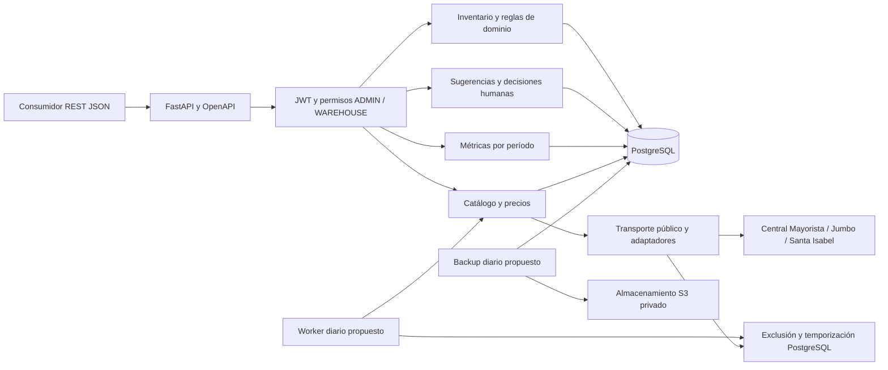

# Evidencia técnica de avance — backend StockSmart E2

Esta evidencia acompaña al [informe de implementación](INFORME_IMPLEMENTACION.md), al [Plan de Pruebas](Plan_Pruebas_Backend_E2.xlsx) y al [contrato](../INTEGRACION_BACKEND.md). Corresponde a pruebas locales/aisladas del backend. El equipo debe incorporarla a la presentación oficial y aportar el video o enlace a la aplicación exigidos por la rúbrica; este documento no acredita esa entrega audiovisual.

## Arquitectura implementada

Stack: Python 3.12.15, FastAPI, Pydantic, SQLAlchemy, Alembic, psycopg y PostgreSQL 17/18. bcrypt protege contraseñas y PyJWT emite tokens propios temporales. httpx consulta las fuentes públicas. La herramienta de respaldos usa pg_dump/pg_restore y boto3. Las versiones resueltas y hashes están en los locks.

Los cron y el almacenamiento están definidos para una futura etapa autorizada. Su presencia en el diagrama no acredita que estén desplegados. No se creó frontend ni se ejecutan compras externas.

## Recorrido demostrado

1. Preparar una base vacía y descartable `_test`, migrar a `0005_e2_completion` y cargar la demostración mediante `app.demo`; el procedimiento completo está en [OPERACION.md](OPERACION.md).
2. Aprovisionar una cuenta por la consola privada `app.manage_users` y obtener JWT en `POST /auth/login`.
3. Consultar inventario y adquirir precios con `POST /prices/{item_id}/refresh`. No se importan precios fijos como actuales.
4. `POST /suggestions` genera un snapshot PENDING sin alterar stock ni crear una orden.
5. `POST /suggestions/{id}/decision` permite a ADMIN aprobar, o rechazar con motivo. Aprobar registra una OC interna; no compra al proveedor.
6. Consultar `GET /orders` y registrar la recepción. Un reintento idéntico conserva el mismo movimiento y no duplica existencias.
7. Consultar historial, conteos y métricas por período. La falta de línea base conserva el impacto E3 como no verificable.

La demostración usa historia sintética congelada del Dataset v2. La observación de precios públicos es una consulta fechada, sin compra ni garantía de condiciones comerciales del negocio. Los plazos del laboratorio son supuestos sintéticos.

## Resultados y referencias

- 357 tests en PostgreSQL 17 y otros 357 en PostgreSQL 18, sin fallos ni omisiones.
- 220 casos originales conservados; una expectativa corregida contra RN-07. El hash del Dataset v2 coincide con `5333503`.
- S=1, W=7, L=4, T=0 produce P=−3 y Q=17; el stock físico permanece no negativo.
- Se probaron 401/403, usuario inactivo, JWT inválido/vencido, decisiones concurrentes, rollback, snapshot obsoleto y recepción idempotente.
- Ensayo HTTP real desde el wheel instalado: login, CORS, tres fuentes, sugerencia, aprobación, recepción, lecturas concurrentes, caída y reconexión PostgreSQL.
- Migraciones limpias y desde 0004 poblado; respaldo y restore reales en bases aisladas. S3 está probado con mocks.
- [Verificación reproducible y hashes](VERIFICACION.json), [matriz completa](MATRIZ_TRAZABILIDAD_FINAL.csv), [19 tareas](BACKLOG_FINAL.json), [22 hallazgos](HALLAZGOS_FINAL.json) y [resultado CI](CI_RESULTADO.json).

El funcionamiento real de Render, la continuidad de sus recursos y los jobs remotos siguen sin verificar. No se atribuye a estas pruebas cumplimiento de las metas 30/20/5. La rúbrica exige además evidencia audiovisual o acceso demostrable y revisión del equipo.
